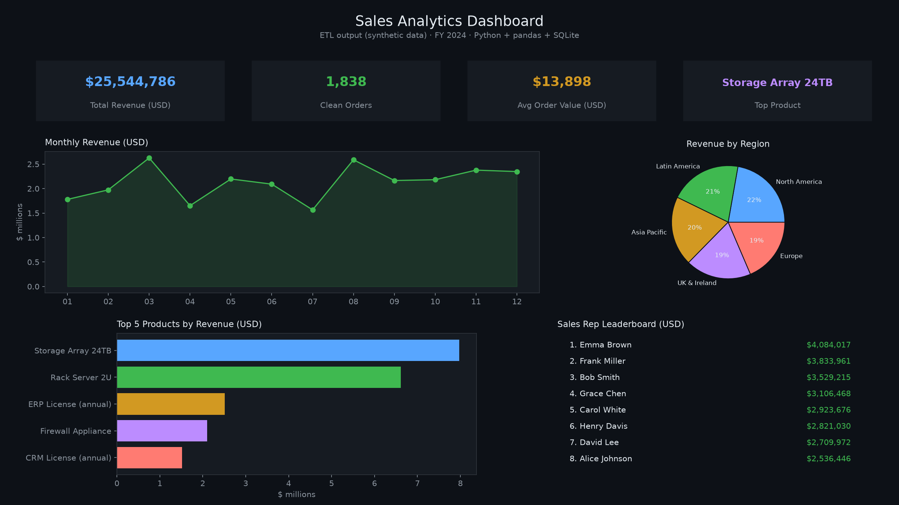
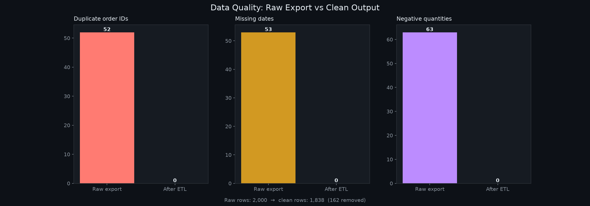
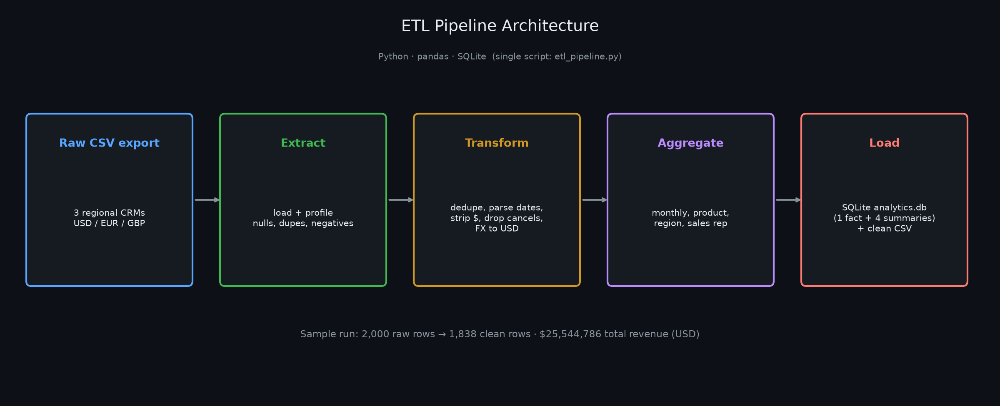
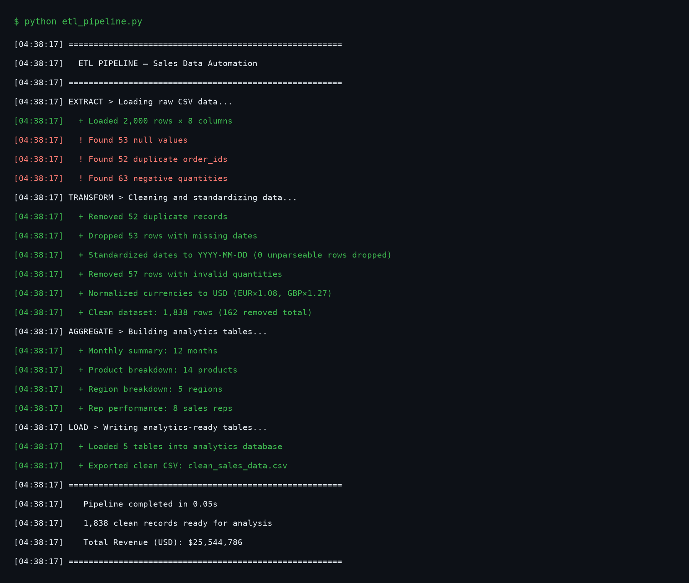

# Sales Data ETL Pipeline

**Scenario:** B2B enterprise IT hardware & software distributor (synthetic sample data; no real client data)  
**Scope:** Automated ETL pipeline — raw multi-currency sales exports → clean analytical database  
**Engineer:** Jaimin Babariya (Data Engineer)  
**Note:** Built as a freelance-style practice deliverable; all data is synthetic.

---

## Business Problem

The scenario models a distributor of enterprise IT products (network hardware, ERP/CRM licenses, server infrastructure) across five global regions. Its sales team exported orders from three regional CRM systems (USD, EUR, GBP) with inconsistent formatting — mixed date formats, missing dates, `$`-prefixed prices, duplicate order IDs from system retries, and negative quantities from cancelled lines not being voided correctly. Finance needed a single clean dataset for monthly reporting without manual Excel cleanup.

`generate_sample_data.py` creates a synthetic export with exactly these problems (seeded, so runs are reproducible).

This pipeline automates the full Extract → Transform → Load cycle and produces a normalized analytics database ready for BI tooling.

---

## What It Does

**Extract** — reads the raw CSV export, checks required columns, logs row count and data quality issues upfront.

**Transform:**
- Deduplicates on `order_id` (keeps first occurrence)
- Drops rows with missing `order_date`
- Parses mixed date formats (`MM/DD/YYYY`, `YYYY-MM-DD`, `DD-Mon-YYYY`) to `YYYY-MM-DD`, dropping any unparseable rows
- Strips `$` symbols from `unit_price` and casts to float
- Removes negative-quantity lines (cancelled orders)
- Recalculates `total_revenue = quantity × unit_price`
- Normalizes all revenue to USD using fixed FX rates (EUR×1.08, GBP×1.27)

**Aggregate** — builds four summary tables: monthly summary, product breakdown, region breakdown, sales rep performance.

**Load** — writes all five tables (1 fact + 4 summaries) to a SQLite analytics database and exports a clean CSV alongside.

---

## Output

Created in `output/` each time the pipeline runs (not committed to the repo).

| File | Description |
|---|---|
| `output/analytics.db` | SQLite database with 5 tables (fact_sales + summary tables dim_monthly, dim_product, dim_region, dim_sales_rep) |
| `output/clean_sales_data.csv` | Fully cleaned and normalized flat file |
| `output/monthly_summary.csv` | Month-level revenue and order count aggregation |
| `output/pipeline_run.log` | Timestamped run log with before/after row counts |

---

## Pipeline Results

From a run on the generated sample (`python generate_sample_data.py && python etl_pipeline.py`; the screenshots below are rendered from this run by `make_screenshots.py`):

```
Loaded:    2,000 raw rows
Cleaned:   1,838 rows (162 removed)
  - 52 duplicate order_ids removed
  - 53 rows with missing dates dropped
  - 57 negative-quantity lines removed
Total Revenue (USD): $25,544,786
```

---

## Project Structure

```
sales-etl-pipeline/
├── generate_sample_data.py  # Synthetic raw export with dupes, missing/mixed dates, $ prices, cancels
├── etl_pipeline.py          # Extract → Transform → Aggregate → Load
├── make_screenshots.py      # Renders screenshots/ from the run's outputs
├── tests/test_etl.py        # Date parsing + transform rules
├── requirements.txt
├── output/                  # Created when the pipeline runs (git-ignored)
│   ├── analytics.db
│   ├── clean_sales_data.csv
│   ├── monthly_summary.csv
│   └── pipeline_run.log
└── screenshots/
    ├── 01_executive_dashboard.png
    ├── 02_data_quality_report.png
    ├── 03_pipeline_architecture.png
    └── 04_pipeline_terminal_log.png
```

---

## Running Locally

```bash
pip install -r requirements.txt
python generate_sample_data.py      # raw_sales_data.csv (2,000 synthetic rows)
python etl_pipeline.py              # output/ database, CSVs and run log
python make_screenshots.py          # optional: re-render screenshots/
pytest tests/
```

## Screenshots (rendered from the sample run)

| Dashboard | Data quality |
|---|---|
|  |  |
| **Architecture** | **Run log** |
|  |  |
